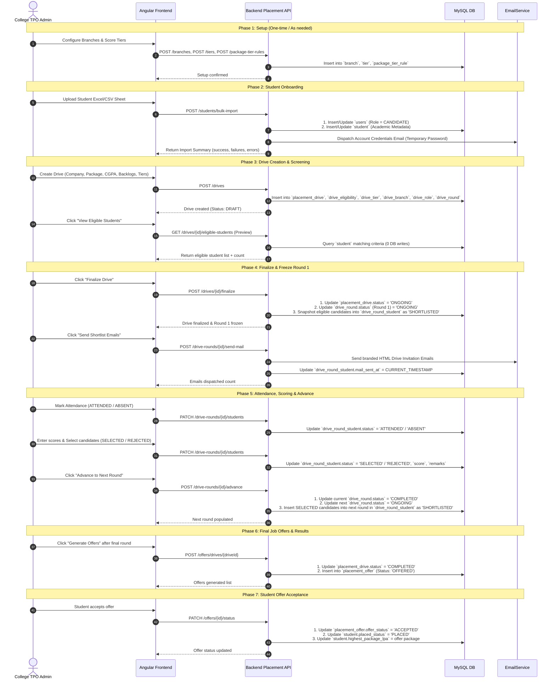

# PROVEYU — Campus Placement Module Frontend Handover & API Guide

This document provides a complete, production-grade integration guide for Frontend Developers building and connecting the **College Placement & Recruitment Portal** on PROVEYU.

---

## 1. Overview & Base Configuration

### 1.1 Base URL
- **Development**: `http://localhost:8080/api/v1/placement`
- **Production**: `https://api.proveyu.com/api/v1/placement`

### 1.2 Authentication & Headers
All placement endpoints require an authenticated user with role `ORGANIZATION` (College Admin / TPO) or `ADMIN`.
- **Authorization Header**: `Authorization: Bearer <jwt_token>`
- **Content-Type**: `application/json`

*(The College context is automatically resolved from the authenticated JWT token. Optionally, an explicit `?collegeId=<UUID>` query parameter can be passed).*

### 1.3 Standard API Response Structure
All REST responses follow the unified `ApiResponse<T>` format:
```typescript
export interface ApiResponse<T> {
  success: boolean;
  message: string;
  data: T;
  errorCode: string | null;
  timestamp: string; // ISO 8601 string
}
```

---

## 2. Frontend UI Page Mapping

| Frontend Page / Component | Features & Purpose | Primary API Endpoints |
| :--- | :--- | :--- |
| **`/college/settings/profile` & departments** | Manage College Branches | `GET /branches`, `POST /branches`, `DELETE /branches/{id}` |
| **`/college/settings/test-config`** | Configure Student Tiers & Package Rules | `GET /tiers`, `POST /tiers`, `GET /package-tier-rules`, `POST /package-tier-rules` |
| **`/college/students`** | Student Directory & Academic Profiles | `GET /students`, `GET /students/{id}`, `POST /students` |
| **`/college/students/student-import`** | Bulk Excel / CSV Student Onboarding | `POST /students/bulk-import` |
| **`/college/companies`** | Recruiting Company Catalog | `GET /companies`, `POST /companies`, `PUT /companies/{id}` |
| **`/college/placements`** | Placement Drives List & Status Filters | `GET /drives`, `POST /drives/{id}/cancel` |
| **`/college/placements/add-requirement`** | Create Drive with Academic Requirements | `POST /drives` |
| **Eligible Preview Modal** | Real-time candidate screening preview (0 DB writes) | `GET /drives/{id}/eligible-students` |
| **Finalize & Freeze Action** | Snapshots eligible candidates into Round 1 as Shortlisted | `POST /drives/{id}/finalize` |
| **Selection Pipeline Modal** | Drive Rounds, Counts, Student Attendance & Selection | `GET /drives/{id}/rounds`, `GET /drive-rounds/{id}/students`, `PATCH /drive-rounds/{id}/students` |
| **Advance Round Action** | Move `SELECTED` candidates to the next round | `POST /drive-rounds/{id}/advance` |
| **Shortlist Email Action** | Send batch invite emails to shortlisted students | `POST /drive-rounds/{id}/send-mail` |
| **`/college/results` & Offers** | Convert selected candidates to Job Offers & Accept/Reject | `POST /offers/drives/{driveId}`, `GET /offers`, `PATCH /offers/{id}/status` |

---

## 3. End-to-End Placement Workflow & Database State Machine

### 3.1 Flow Sequence Diagram



---

### 3.2 Flow Breakdown & Database Table Mutation Matrix

The table below summarizes **how each step functions** and **which exact database tables are created, read, or updated**:

| Flow Phase | Action | Endpoint | Tables Read | Tables Inserted / Written | Tables Updated (Columns Changed) |
| :--- | :--- | :--- | :--- | :--- | :--- |
| **1. College Setup** | Add Branch | `POST /branches` | `organizations` | `branch` | — |
| | Add Score Tier | `POST /tiers` | `organizations` | `tier` | — |
| | Add Package Rule | `POST /package-tier-rules` | `tier`, `organizations` | `package_tier_rule` | — |
| **2. Student Onboarding** | Bulk Sheet Upload | `POST /students/bulk-import` | `branch`, `users`, `student` | `users` (if new), `student` (if new) | `users` (`phone`, `fullName`), `student` (`cgpa`, `score`, `10th%`, `12th%`, `backlogs`, `gapYears`) |
| **3. Company & Drive Creation** | Add Company | `POST /companies` | `company` | `company` | — |
| | Create Drive | `POST /drives` | `company`, `package_tier_rule`, `hiring_round` | `placement_drive`, `drive_eligibility`, `drive_tier`, `drive_branch`, `drive_role`, `drive_round` | — |
| **4. Screening & Freeze** | Preview Eligible Students | `GET /drives/{id}/eligible-students` | `student`, `tier`, `branch`, `users`, `placement_drive`, `drive_eligibility`, `drive_tier`, `drive_branch` | **NONE (Zero DB Writes)** | **NONE (0 Writes)** |
| | Finalize & Freeze Round 1 | `POST /drives/{id}/finalize` | `student`, `placement_drive`, `drive_round` | `drive_round_student` | `placement_drive` (`status` $\rightarrow$ `ONGOING`), `drive_round` (`status` $\rightarrow$ `ONGOING`) |
| **5. Round Execution** | Send Shortlist Emails | `POST /drive-rounds/{id}/send-mail` | `drive_round_student`, `users`, `placement_drive`, `company`, `hiring_round` | — | `drive_round_student` (`mail_sent_at` = `NOW()`) |
| | Update Attendance / Scores | `PATCH /drive-rounds/{id}/students` | `drive_round_student` | — | `drive_round_student` (`status`, `score`, `remarks`, `updated_at`) |
| | Complete Round | `POST /drive-rounds/{id}/complete` | `drive_round` | — | `drive_round` (`status` $\rightarrow$ `COMPLETED`) |
| | Advance to Next Round | `POST /drive-rounds/{id}/advance` | `drive_round`, `drive_round_student` | `drive_round_student` (new rows for next round) | `drive_round` (current $\rightarrow$ `COMPLETED`, next $\rightarrow$ `ONGOING`) |
| **6. Offers & Results** | Generate Offers | `POST /offers/drives/{driveId}` | `drive_round`, `drive_round_student`, `placement_drive` | `placement_offer` | `placement_drive` (`status` $\rightarrow$ `COMPLETED`) |
| | Accept / Reject Offer | `PATCH /offers/{id}/status` | `placement_offer`, `student` | — | `placement_offer` (`offer_status` $\rightarrow$ `ACCEPTED`/`REJECTED`), `student` (`placed_status` $\rightarrow$ `PLACED`, `highest_package_lpa`) |

---

### 3.3 Detailed Step-by-Step Flow & State Transitions

#### Phase 1: Initial College Setup
1. **Branch Creation (`POST /branches`)**:
   - College creates departments (e.g. `CSE`, `ECE`, `MECH`).
   - **Data saved in `branch`**: `branch_id`, `college_id`, `branch_name`, `branch_code`.
2. **Tier Configuration (`POST /tiers`)**:
   - Defines student score brackets. (e.g. Tier 1 = Score $\ge 80$, Tier 2 = Score $\ge 70$, Tier 3 = Score $\ge 60$).
   - **Data saved in `tier`**: `tier_id`, `college_id`, `tier_level` (1 is best), `tier_name`, `min_score`.
   - *Note*: Tiers are **never hardcoded on student rows**; a student's tier is dynamically derived from their current assessment score.
3. **Package Tier Rules (`POST /package-tier-rules`)**:
   - Defines default tier eligibility for salary packages (e.g. $[8.0, 15.0)$ LPA $\rightarrow$ Tier 1).
   - **Data saved in `package_tier_rule`**: `rule_id`, `college_id`, `min_package_lpa`, `max_package_lpa`, `tier_id`.

---

#### Phase 2: Student Onboarding & Account Provisioning
1. **Bulk Upload (`POST /students/bulk-import`)**:
   - TPO uploads an Excel or CSV file parsed into an array of JSON objects.
   - **Data saved in `users` table**:
     - `id` (UUID), `email`, `full_name`, `phone`, `password_hash` (BCrypt hash of an auto-generated random password), `role = 'CANDIDATE'`, `active = true`.
   - **Data saved in `student` table**:
     - `student_id` (= `users.id`), `college_id`, `branch_id`, `roll_number`, `cgpa`, `score`, `tenth_percent`, `twelfth_percent`, `active_backlogs`, `gap_years`, `placed_status = 'UNPLACED'`.
   - **Email Dispatch**:
     - The backend triggers `EmailService.sendStudentCredentialsEmail()` asynchronously, sending the student their login email and temporary password.

---

#### Phase 3: Company Setup & Placement Drive Creation
1. **Create Company (`POST /companies`)**:
   - **Data saved in `company`**: `company_id`, `name`, `category`, `website`.
2. **Create Drive (`POST /drives`)**:
   - TPO fills out the drive form with salary package, drive date, location, eligibility rules, and applicable branches/tiers.
   - **Data saved in database**:
     - `placement_drive`: Stores `drive_id`, `college_id`, `company_id`, `offered_package`, `drive_date`, `location`, `placed_policy`, and initializes `status = 'DRAFT'`.
     - `drive_eligibility`: Stores minimum thresholds (`min_cgpa`, `min_score`, `min_10th_percent`, `min_12th_percent`, `max_active_backlogs`, `max_gap_years`).
     - `drive_tier`: Auto-filled using `package_tier_rule` matching `offered_package`, or manual overrides.
     - `drive_branch`: Stores selected branches (if empty, all branches are eligible).
     - `drive_role`: Stores job roles (e.g. "Software Engineer").
     - `drive_round`: Initializes ordered hiring rounds (Round 1: Online Assessment, Round 2: Technical Interview, etc.) with `status = 'PENDING'`.

---

#### Phase 4: Screening, Preview & Freeze
1. **Preview Eligible Candidates (`GET /drives/{id}/eligible-students`)**:
   - **Zero Database Writes**: Computes real-time eligibility across the `student` pool:
     - Student's derived tier is in `drive_tier`.
     - Student's branch is in `drive_branch` (or all branches if none selected).
     - All non-null academic criteria pass (`cgpa`, `score`, `10th%`, `12th%`, `backlogs`, `gapYears`).
     - Placed policy passes (`EXCLUDE_ALL`: skip placed; `ONLY_IF_HIGHER_PACKAGE`: only if drive package > student's current package).
   - Returns the eligible student array and total count to display in the UI modal.
2. **Finalize & Freeze Drive (`POST /drives/{id}/finalize`)**:
   - **Snapshotting**: The eligible student list is frozen into Round 1 of `drive_round_student`:
     - **Data inserted into `drive_round_student`**: `id`, `drive_round_id` (= Round 1 ID), `student_id`, `status = 'SHORTLISTED'`, `mail_sent_at = NULL`.
     - **Data updated in `placement_drive`**: `status` transitions from `DRAFT` $\rightarrow$ `ONGOING`.
     - **Data updated in `drive_round`**: Round 1 `status` transitions from `PENDING` $\rightarrow$ `ONGOING`.
   - *Guarantee*: Subsequent updates to student grades, backlogs, or profiles will **not** alter this frozen shortlist snapshot.

---

#### Phase 5: Selection Pipeline, Round Advancement & Emails
1. **Send Shortlist Emails (`POST /drive-rounds/{id}/send-mail`)**:
   - Backend queries all candidates in that round where `status = 'SHORTLISTED'` and `mail_sent_at IS NULL`.
   - Sends customized HTML emails via `EmailService`.
   - **Data updated in `drive_round_student`**: Sets `mail_sent_at = CURRENT_TIMESTAMP`.
2. **Attendance & Evaluation (`PATCH /drive-rounds/{id}/students`)**:
   - TPO updates candidate progress:
     $$\text{SHORTLISTED} \longrightarrow \begin{cases} \text{ATTENDED} \longrightarrow \begin{cases} \text{SELECTED} \\ \text{REJECTED} \end{cases} \\ \text{ABSENT} \end{cases}$$
   - **Data updated in `drive_round_student`**: `status`, `score`, `remarks`, `updated_at`.
   - *Validation*: Absent candidates cannot be marked selected.
3. **Round Advancement (`POST /drive-rounds/{id}/advance`)**:
   - Queries all candidates with `status = 'SELECTED'` in the current round.
   - Finds the next round in sequence by `round_number` (supports skipped rounds, e.g. Round 1 $\rightarrow$ Round 3).
   - **Data updated in `drive_round`**:
     - Current round: `status = 'COMPLETED'`.
     - Next round: `status = 'ONGOING'`.
   - **Data inserted into `drive_round_student`**:
     - Creates new rows for the next round with `status = 'SHORTLISTED'`.

---

#### Phase 6: Job Offers & Placement Confirmation
1. **Generate Offers (`POST /offers/drives/{driveId}`)**:
   - Executed after the final round of the drive is completed.
   - Automatically queries all candidates who achieved `status = 'SELECTED'` in the final round.
   - **Data updated in `placement_drive`**: `status` transitions from `ONGOING` $\rightarrow$ `COMPLETED`.
   - **Data inserted into `placement_offer`**:
     - `offer_id`, `drive_id`, `student_id`, `role_name`, `package_lpa`, `offer_status = 'OFFERED'`, `offered_at`.
2. **Acceptance / Rejection (`PATCH /offers/{offerId}/status`)**:
   - When an offer is marked `ACCEPTED`:
     - **Data updated in `placement_offer`**: `offer_status = 'ACCEPTED'`.
     - **Data updated in `student`**:
       - `placed_status = 'PLACED'`.
       - `highest_package_lpa = MAX(highest_package_lpa, offer.package_lpa)`.
   - If marked `REJECTED`: `placement_offer.offer_status = 'REJECTED'`.

---

### 3.4 Table-by-Table Data Storage Directory ("Which Table Saves What Data")

The table below explains exactly **which table stores which data**, **which flow phase and API triggers it**, and **its primary role in the placement ecosystem**:

| # | Database Table | Flow Phase & Triggering API | Key Columns Saved / Updated | Purpose & Business Logic |
| :--- | :--- | :--- | :--- | :--- |
| **1** | `users` | **Phase 2 (Student Onboarding)**<br/>`POST /students/bulk-import`<br/>`POST /students` | `id` (UUID), `email`, `full_name`, `phone`, `password_hash` (BCrypt), `role = 'CANDIDATE'`, `active = true` | Base login credentials for each student. Created automatically with temporary passwords so candidates can access their student portal. |
| **2** | `student` | **Phase 2 (Onboarding)** & **Phase 7 (Offer Accept)**<br/>`POST /students/bulk-import`<br/>`PATCH /offers/{id}/status` | `student_id` (FK to `users.id`), `college_id` (FK to `organizations.id`), `branch_id`, `roll_number`, `cgpa`, `score`, `tenth_percent`, `twelfth_percent`, `active_backlogs`, `gap_years`, `placed_status` (`UNPLACED`/`PLACED`), `highest_package_lpa` | Stores student academic profile and placement status. Evaluated on the fly against drive eligibility criteria. Updated when job offers are accepted. |
| **3** | `company` | **Phase 3 (Company Catalog)**<br/>`POST /companies`<br/>`PUT /companies/{id}` | `company_id` (UUID), `name`, `category` (IT, Core, etc.), `website`, `created_at` | Catalog of visiting recruiters and organizations conducting on-campus recruitment. |
| **4** | `branch` | **Phase 1 (College Setup)**<br/>`POST /branches` | `branch_id` (UUID), `college_id` (FK to `organizations.id`), `branch_name`, `branch_code`, `created_at` | College departments (e.g. CSE, ECE, MECH). Used to categorize students and filter candidates eligible for a drive. |
| **5** | `tier` | **Phase 1 (College Setup)**<br/>`POST /tiers` | `tier_id` (UUID), `college_id` (FK to `organizations.id`), `tier_level` (1=highest), `tier_name`, `min_score`, `created_at` | College-level score brackets (e.g., Tier 1 $\ge 80$, Tier 2 $\ge 70$). A student's tier is dynamically evaluated based on their test score (`score >= min_score`). |
| **6** | `package_tier_rule` | **Phase 1 (College Setup)**<br/>`POST /package-tier-rules` | `rule_id` (UUID), `college_id`, `min_package_lpa`, `max_package_lpa` (NULL = no upper limit), `tier_id` | Automated tier eligibility rules for salary brackets. When creating a drive, matching tiers are automatically applied based on `offered_package`. |
| **7** | `placement_drive` | **Phase 3 (Create)**, **Phase 4 (Freeze)**, **Phase 6 (Offers)**<br/>`POST /drives`<br/>`POST /drives/{id}/finalize`<br/>`POST /offers/drives/{id}`<br/>`POST /drives/{id}/cancel` | `drive_id` (UUID), `college_id`, `company_id`, `offered_package`, `drive_date`, `location`, `placed_policy` (`EXCLUDE_ALL`, `INCLUDE_ALL`, `ONLY_IF_HIGHER_PACKAGE`), `status` (`DRAFT` $\rightarrow$ `ONGOING` $\rightarrow$ `COMPLETED` / `CANCELLED`), `created_at`, `updated_at` | Master entity for a campus recruitment event. Governs lifecycle, salary package, policy on already-placed candidates, and drive status. |
| **8** | `drive_eligibility` | **Phase 3 (Drive Creation)**<br/>`POST /drives` | `drive_id` (PK & FK), `min_cgpa`, `min_score`, `min_10th_percent`, `min_12th_percent`, `max_active_backlogs`, `max_gap_years` | Specific academic cutoffs for the drive (1:1 with `placement_drive`). Any `null` column means that specific criterion is not enforced. |
| **9** | `drive_tier` | **Phase 3 (Drive Creation)**<br/>`POST /drives` | `drive_id`, `tier_id` (composite PK) | Stores which student score tiers are eligible for the drive. Auto-populated from `package_tier_rule` or customized by the TPO. |
| **10** | `drive_branch` | **Phase 3 (Drive Creation)**<br/>`POST /drives` | `drive_id`, `branch_id` (composite PK) | Restricts the drive to specific departments (e.g. CSE, IT). If no branches are linked, the drive is open to all branches. |
| **11** | `drive_role` | **Phase 3 (Drive Creation)**<br/>`POST /drives` | `drive_role_id` (UUID), `drive_id`, `role_name` | Job roles being hired (e.g. "Software Development Engineer", "Data Analyst"). |
| **12** | `hiring_round` | **System Seed / Master Data** | `round_id` (UUID), `round_name` | Master lookup of standard recruitment stages: Online Assessment, Coding Assessment, Group Discussion, Technical Round 1, Technical Round 2, HR Round. |
| **13** | `drive_round` | **Phase 3 (Creation)** & **Phase 5 (Advancement)**<br/>`POST /drives`<br/>`POST /drives/{id}/finalize`<br/>`POST /drive-rounds/{id}/advance`<br/>`POST /drive-rounds/{id}/complete` | `drive_round_id` (UUID), `drive_id`, `round_id`, `round_number` (1, 2, 3...), `round_date`, `status` (`PENDING` $\rightarrow$ `ONGOING` $\rightarrow$ `COMPLETED`) | Ordered round pipeline for the drive. Candidate counts (shortlisted, attended, selected, rejected) are computed on the fly from `drive_round_student`. |
| **14** | `drive_round_student` | **Phase 4 (Finalize Freeze)**, **Phase 5 (Attendance, Scoring, Advance)**<br/>`POST /drives/{id}/finalize`<br/>`POST /drive-rounds/{id}/send-mail`<br/>`PATCH /drive-rounds/{id}/students`<br/>`POST /drive-rounds/{id}/advance` | `id` (UUID), `drive_round_id`, `student_id`, `status` (`SHORTLISTED`, `ATTENDED`, `ABSENT`, `SELECTED`, `REJECTED`), `score`, `remarks`, `mail_sent_at`, `updated_at` | The heartbeat of candidate evaluation. Freezes the initial eligible snapshot into Round 1 as `SHORTLISTED`, tracks attendance, scores, selection decisions, email dispatch timestamp, and populates subsequent rounds upon advancement. |
| **15** | `placement_offer` | **Phase 6 (Offers)** & **Phase 7 (Acceptance)**<br/>`POST /offers/drives/{driveId}`<br/>`PATCH /offers/{id}/status` | `offer_id` (UUID), `drive_id`, `student_id`, `role_name`, `package_lpa`, `offer_status` (`OFFERED`, `ACCEPTED`, `REJECTED`), `offered_at` | Official job offers extended to final-round selected candidates. When accepted, triggers updating the student's status to `PLACED` and records their package in the `student` table. |

---

## 4. REST API Specification

### 4.1 Company Management

#### `POST /companies` — Create Recruiting Company
- **Description**: Add a new company participating in campus recruitment.
- **Request Body**:
```json
{
  "name": "Google India",
  "category": "Product / Technology",
  "website": "https://careers.google.com"
}
```
- **Response (`201 Created`)**:
```json
{
  "success": true,
  "message": "Company created successfully",
  "data": {
    "companyId": "9b1deb4d-3b7d-4bad-9bdd-2b0d7b3dcb6d",
    "name": "Google India",
    "category": "Product / Technology",
    "website": "https://careers.google.com",
    "createdAt": "2026-10-19T14:00:00Z"
  }
}
```

#### `GET /companies` — List Companies
- **Response (`200 OK`)**: List of `CompanyResponse` objects.

---

### 4.2 Branch Management (College Departments)

#### `POST /branches` — Create College Branch
- **Request Body**:
```json
{
  "branchName": "Computer Science & Engineering",
  "branchCode": "CSE"
}
```
- **Response (`201 Created`)**:
```json
{
  "success": true,
  "message": "Branch created successfully",
  "data": {
    "branchId": "e1f13b1d-88b1-4f32-bb12-32b0a1d4f201",
    "collegeId": "5dc3d378-42f5-4a3a-8407-d5d1cf3712a1",
    "branchName": "Computer Science & Engineering",
    "branchCode": "CSE",
    "createdAt": "2026-10-19T14:05:00Z"
  }
}
```

#### `GET /branches` — List College Branches
- **Response (`200 OK`)**: List of all branches registered under the logged-in college.

---

### 4.3 Student Tier & Package Rule Configuration

#### `POST /tiers` — Create Student Score Tier
- **Description**: Configures college score brackets (e.g. Tier 1 = Score $\ge 80$, Tier 2 = Score $\ge 70$, Tier 3 = Score $\ge 60$). Tier 1 is highest priority.
- **Request Body**:
```json
{
  "tierLevel": 1,
  "tierName": "Tier 1",
  "minScore": 80.0
}
```
- **Response (`201 Created`)**:
```json
{
  "success": true,
  "message": "Tier created successfully",
  "data": {
    "tierId": "c4d32a10-2210-410a-810a-112233445566",
    "collegeId": "5dc3d378-42f5-4a3a-8407-d5d1cf3712a1",
    "tierLevel": 1,
    "tierName": "Tier 1",
    "minScore": 80.00,
    "createdAt": "2026-10-19T14:10:00Z"
  }
}
```

#### `GET /tiers` — List Tiers
- **Response (`200 OK`)**: Tiers ordered by `tierLevel` ascending.

#### `POST /package-tier-rules` — Map Package Range to Eligible Tier
- **Description**: Configures default tier eligibility for a package bracket. Range is $[min, max)$. If `maxPackageLpa` is `null`, it represents no upper ceiling.
- **Request Body**:
```json
{
  "minPackageLpa": 8.0,
  "maxPackageLpa": 15.0,
  "tierId": "c4d32a10-2210-410a-810a-112233445566"
}
```
- **Response (`201 Created`)**:
```json
{
  "success": true,
  "message": "Package tier rule created successfully",
  "data": {
    "ruleId": "f7e6d5c4-b3a2-4190-8877-665544332211",
    "collegeId": "5dc3d378-42f5-4a3a-8407-d5d1cf3712a1",
    "minPackageLpa": 8.00,
    "maxPackageLpa": 15.00,
    "tierId": "c4d32a10-2210-410a-810a-112233445566",
    "tierName": "Tier 1",
    "createdAt": "2026-10-19T14:15:00Z"
  }
}
```

#### `GET /package-tier-rules` — List Package Tier Rules

---

### 4.4 Student Academic Directory & Bulk Import

#### `POST /students/bulk-import` — Bulk Student Excel/CSV Import
- **Description**: College uploads a parsed sheet of students. The backend:
  1. Finds or creates each student's `users` account (`Role.CANDIDATE`).
  2. Generates an auto-password and sends account credentials via email.
  3. Saves academic placement criteria (`cgpa`, `score`, `tenthPercent`, `twelfthPercent`, `activeBacklogs`, `gapYears`).
- **Request Body**: Array of `StudentImportRow`:
```json
[
  {
    "name": "Aarav Patel",
    "email": "aarav.patel@student.college.edu",
    "phone": "+919876543210",
    "rollNumber": "2024CS001",
    "branchCode": "CSE",
    "cgpa": 8.65,
    "score": 86.50,
    "tenthPercent": 92.40,
    "twelfthPercent": 89.20,
    "activeBacklogs": 0,
    "gapYears": 0
  },
  {
    "name": "Isha Sen",
    "email": "isha.sen@student.college.edu",
    "phone": "+919876543211",
    "rollNumber": "2024CS002",
    "branchCode": "CSE",
    "cgpa": 7.40,
    "score": 72.00,
    "tenthPercent": 85.00,
    "twelfthPercent": 81.00,
    "activeBacklogs": 0,
    "gapYears": 0
  }
]
```
- **Response (`200 OK`)**:
```json
{
  "success": true,
  "message": "Bulk import completed",
  "data": {
    "totalProcessed": 2,
    "successCount": 2,
    "failureCount": 0,
    "errors": []
  }
}
```

#### `GET /students` — List College Students
- **Description**: Returns all students of the college with their dynamically derived tier (`Tier 1`, `Tier 2`, `Tier 3`, or `null`).
- **Response (`200 OK`)**: Array of `EligibleStudentResponse`:
```json
{
  "success": true,
  "data": [
    {
      "studentId": "0d2c3e4f-5a6b-4c7d-8e9f-0a1b2c3d4e5f",
      "fullName": "Aarav Patel",
      "email": "aarav.patel@student.college.edu",
      "phone": "+919876543210",
      "rollNumber": "2024CS001",
      "branchId": "e1f13b1d-88b1-4f32-bb12-32b0a1d4f201",
      "branchName": "Computer Science & Engineering",
      "cgpa": 8.65,
      "score": 86.50,
      "tenthPercent": 92.40,
      "twelfthPercent": 89.20,
      "activeBacklogs": 0,
      "gapYears": 0,
      "tierName": "Tier 1",
      "tierLevel": 1,
      "placedStatus": "UNPLACED",
      "highestPackageLpa": null
    }
  ]
}
```

---

### 4.5 Placement Drive Lifecycle

#### `POST /drives` — Create Placement Drive
- **Description**: Creates a recruitment drive with company, package, academic criteria, and participating branches/tiers in a single request.
- **Request Body**:
```json
{
  "companyId": "9b1deb4d-3b7d-4bad-9bdd-2b0d7b3dcb6d",
  "offeredPackage": 12.5,
  "driveDate": "2026-11-20",
  "location": "Campus Main Auditorium / Hybrid",
  "placedPolicy": "EXCLUDE_ALL",
  "eligibility": {
    "minCgpa": 7.50,
    "minScore": 75.00,
    "min10thPercent": 70.00,
    "min12thPercent": 70.00,
    "maxActiveBacklogs": 0,
    "maxGapYears": 1
  },
  "tierIds": ["c4d32a10-2210-410a-810a-112233445566"],
  "branchIds": ["e1f13b1d-88b1-4f32-bb12-32b0a1d4f201"],
  "roles": ["Associate Software Engineer", "Systems Analyst"],
  "roundIds": [
    "11111111-1111-1111-1111-111111111101",
    "11111111-1111-1111-1111-111111111102",
    "11111111-1111-1111-1111-111111111104",
    "11111111-1111-1111-1111-111111111106"
  ]
}
```

> **Placed Policies**:
> - `EXCLUDE_ALL`: Only unplaced students (`placedStatus === 'UNPLACED'`).
> - `INCLUDE_ALL`: All students.
> - `ONLY_IF_HIGHER_PACKAGE`: Allows placed students only if `drive.offeredPackage > student.highestPackageLpa`.

- **Response (`201 Created`)**:
```json
{
  "success": true,
  "message": "Placement drive created successfully",
  "data": {
    "driveId": "2a3b4c5d-6e7f-4890-a1b2-c3d4e5f6a7b8",
    "collegeId": "5dc3d378-42f5-4a3a-8407-d5d1cf3712a1",
    "companyId": "9b1deb4d-3b7d-4bad-9bdd-2b0d7b3dcb6d",
    "companyName": "Google India",
    "offeredPackage": 12.50,
    "driveDate": "2026-11-20",
    "location": "Campus Main Auditorium / Hybrid",
    "placedPolicy": "EXCLUDE_ALL",
    "status": "DRAFT",
    "eligibility": {
      "minCgpa": 7.50,
      "minScore": 75.00,
      "min10thPercent": 70.00,
      "min12thPercent": 70.00,
      "maxActiveBacklogs": 0,
      "maxGapYears": 1
    },
    "tiers": [
      {
        "tierId": "c4d32a10-2210-410a-810a-112233445566",
        "tierName": "Tier 1",
        "tierLevel": 1,
        "minScore": 80.00
      }
    ],
    "branches": [
      {
        "branchId": "e1f13b1d-88b1-4f32-bb12-32b0a1d4f201",
        "branchName": "Computer Science & Engineering",
        "branchCode": "CSE"
      }
    ],
    "roles": ["Associate Software Engineer", "Systems Analyst"],
    "createdAt": "2026-10-19T14:20:00Z",
    "updatedAt": "2026-10-19T14:20:00Z"
  }
}
```

#### `GET /drives` — List Placement Drives
- **Query Parameters**:
  - `status`: (Optional) `DRAFT`, `LISTED`, `ONGOING`, `COMPLETED`, `CANCELLED`
  - `driveDate`: (Optional) `YYYY-MM-DD`
- **Response (`200 OK`)**: List of `DriveResponse` objects.

#### `GET /drives/{driveId}/eligible-students` — Preview Eligible Candidates
- **Description**: **Preview mode**. Executes the eligibility engine across the student pool. Writes nothing to the DB.
- **Response (`200 OK`)**:
```json
{
  "success": true,
  "message": "Eligible students preview fetched successfully",
  "data": {
    "totalCount": 1,
    "students": [
      {
        "studentId": "0d2c3e4f-5a6b-4c7d-8e9f-0a1b2c3d4e5f",
        "fullName": "Aarav Patel",
        "email": "aarav.patel@student.college.edu",
        "phone": "+919876543210",
        "rollNumber": "2024CS001",
        "branchName": "Computer Science & Engineering",
        "cgpa": 8.65,
        "score": 86.50,
        "tenthPercent": 92.40,
        "twelfthPercent": 89.20,
        "activeBacklogs": 0,
        "gapYears": 0,
        "tierName": "Tier 1",
        "tierLevel": 1,
        "placedStatus": "UNPLACED",
        "highestPackageLpa": null
      }
    ]
  }
}
```

#### `POST /drives/{driveId}/finalize` — Finalize & Freeze Round 1 Snapshot
- **Description**: **Freeze mode**. Inserts all currently eligible candidates into Round 1 of `drive_round_student` as `SHORTLISTED`. Drive status transitions to `ONGOING`.
- **Response (`200 OK`)**: Confirms finalized candidate list.

---

### 4.6 Rounds & Student Pipeline (Selection Workflow)

#### `GET /drives/{driveId}/rounds` — List Drive Rounds with Counts
- **Description**: Returns all configured rounds in sequence with dynamic candidate counts (`shortlisted`, `attended`, `selected`, `rejected`, `absent`).
- **Response (`200 OK`)**:
```json
{
  "success": true,
  "data": [
    {
      "driveRoundId": "4f5e6d7c-8b9a-4123-b456-c7d8e9f0a1b2",
      "driveId": "2a3b4c5d-6e7f-4890-a1b2-c3d4e5f6a7b8",
      "roundId": "11111111-1111-1111-1111-111111111101",
      "roundName": "Online Assessment",
      "roundNumber": 1,
      "roundDate": "2026-11-20",
      "status": "ONGOING",
      "shortlistedCount": 25,
      "attendedCount": 23,
      "selectedCount": 15,
      "rejectedCount": 8,
      "absentCount": 2,
      "createdAt": "2026-10-19T14:20:00Z"
    },
    {
      "driveRoundId": "5a6b7c8d-9e0f-4234-c567-d8e9f0a1b2c3",
      "driveId": "2a3b4c5d-6e7f-4890-a1b2-c3d4e5f6a7b8",
      "roundId": "11111111-1111-1111-1111-111111111102",
      "roundName": "Coding Assessment",
      "roundNumber": 2,
      "roundDate": "2026-11-21",
      "status": "PENDING",
      "shortlistedCount": 0,
      "attendedCount": 0,
      "selectedCount": 0,
      "rejectedCount": 0,
      "absentCount": 0,
      "createdAt": "2026-10-19T14:20:00Z"
    }
  ]
}
```

#### `GET /drive-rounds/{driveRoundId}/students` — List Students in a Round
- **Query Parameter**: `status` (Optional filter: `SHORTLISTED`, `ATTENDED`, `ABSENT`, `SELECTED`, `REJECTED`)
- **Response (`200 OK`)**:
```json
{
  "success": true,
  "data": [
    {
      "id": "7a8b9c0d-1e2f-4345-d678-e9f0a1b2c3d4",
      "driveRoundId": "4f5e6d7c-8b9a-4123-b456-c7d8e9f0a1b2",
      "studentId": "0d2c3e4f-5a6b-4c7d-8e9f-0a1b2c3d4e5f",
      "fullName": "Aarav Patel",
      "email": "aarav.patel@student.college.edu",
      "rollNumber": "2024CS001",
      "branchName": "Computer Science & Engineering",
      "status": "SHORTLISTED",
      "score": null,
      "remarks": null,
      "mailSentAt": null,
      "updatedAt": "2026-10-19T14:25:00Z"
    }
  ]
}
```

#### `PATCH /drive-rounds/{driveRoundId}/students` — Bulk Update Status & Score
- **Description**: Updates candidate evaluation in a round.
- **Allowed Transitions**:
  - `SHORTLISTED` $\rightarrow$ `ATTENDED` or `ABSENT`
  - `ATTENDED` $\rightarrow$ `SELECTED` or `REJECTED`
  - *Students marked `ABSENT` cannot be marked `SELECTED`.*
- **Request Body**:
```json
{
  "updates": [
    {
      "studentId": "0d2c3e4f-5a6b-4c7d-8e9f-0a1b2c3d4e5f",
      "status": "ATTENDED"
    },
    {
      "studentId": "0d2c3e4f-5a6b-4c7d-8e9f-0a1b2c3d4e5f",
      "status": "SELECTED",
      "score": 94.50,
      "remarks": "Cleared Online Assessment with high algorithmic accuracy"
    }
  ]
}
```

#### `POST /drive-rounds/{driveRoundId}/advance` — Advance Selected to Next Round
- **Description**: Automatically advances all students with status `SELECTED` from the current round into the next round (by `round_number`) as `SHORTLISTED`.
- **Response (`200 OK`)**: Returns details of the newly populated next round.

#### `POST /drive-rounds/{driveRoundId}/send-mail` — Send Shortlist Invitation Emails
- **Description**: Finds all students in that round with `status = 'SHORTLISTED'` where `mail_sent_at IS NULL`. Sends HTML emails and marks `mail_sent_at`.
- **Response (`200 OK`)**:
```json
{
  "success": true,
  "message": "Shortlist emails sent",
  "data": {
    "message": "Shortlist emails dispatched successfully",
    "dispatchedCount": 25
  }
}
```

---

### 4.7 Job Offers & Results

#### `POST /offers/drives/{driveId}` — Generate Offers for Finalists
- **Description**: Converts all `SELECTED` candidates of the final round into formal `placement_offer` rows (`offerStatus = 'OFFERED'`).
- **Request Body** *(Optional role/package override)*:
```json
{
  "roleName": "Associate Software Engineer",
  "packageLpa": 12.50
}
```
- **Response (`201 Created`)**: List of generated `PlacementOfferResponse`.

#### `PATCH /offers/{offerId}/status` — Accept or Reject Offer
- **Description**: Updates offer status. If `ACCEPTED`, automatically sets student's `placedStatus = 'PLACED'` and updates `highestPackageLpa`.
- **Request Body**:
```json
{
  "offerStatus": "ACCEPTED"
}
```

#### `GET /offers` — List Offers
- **Query Parameters**:
  - `driveId`: (Optional) Filter by Drive
  - `studentId`: (Optional) Filter by Student
- **Response (`200 OK`)**: List of offers.

---

## 5. TypeScript Models for Angular

Frontend developers can copy this interface definition directly into `src/app/core/models/placement.models.ts`:

```typescript
export interface ApiResponse<T> {
  success: boolean;
  message: string;
  data: T;
  errorCode: string | null;
  timestamp: string;
}

export type PlacedPolicy = 'EXCLUDE_ALL' | 'INCLUDE_ALL' | 'ONLY_IF_HIGHER_PACKAGE';
export type DriveStatus = 'DRAFT' | 'LISTED' | 'ONGOING' | 'COMPLETED' | 'CANCELLED';
export type RoundStatus = 'PENDING' | 'ONGOING' | 'COMPLETED';
export type RoundStudentStatus = 'SHORTLISTED' | 'ABSENT' | 'ATTENDED' | 'SELECTED' | 'REJECTED';
export type OfferStatus = 'OFFERED' | 'ACCEPTED' | 'REJECTED';
export type PlacedStatus = 'UNPLACED' | 'PLACED';

export interface Company {
  companyId: string;
  name: string;
  category?: string;
  website?: string;
  createdAt: string;
}

export interface Branch {
  branchId: string;
  collegeId: string;
  branchName: string;
  branchCode: string;
  createdAt: string;
}

export interface Tier {
  tierId: string;
  collegeId: string;
  tierLevel: number;
  tierName: string;
  minScore: number;
  createdAt: string;
}

export interface PackageTierRule {
  ruleId: string;
  collegeId: string;
  minPackageLpa: number;
  maxPackageLpa?: number;
  tierId: string;
  tierName?: string;
  createdAt: string;
}

export interface StudentAcademicProfile {
  studentId: string;
  fullName: string;
  email: string;
  phone?: string;
  rollNumber?: string;
  branchId: string;
  branchName: string;
  cgpa?: number;
  score?: number;
  tenthPercent?: number;
  twelfthPercent?: number;
  activeBacklogs: number;
  gapYears: number;
  tierName?: string;
  tierLevel?: number;
  placedStatus: PlacedStatus;
  highestPackageLpa?: number;
}

export interface StudentImportRow {
  name: string;
  email: string;
  phone?: string;
  rollNumber?: string;
  branchCode: string;
  cgpa?: number;
  score?: number;
  tenthPercent?: number;
  twelfthPercent?: number;
  activeBacklogs?: number;
  gapYears?: number;
}

export interface DriveEligibility {
  minCgpa?: number;
  minScore?: number;
  min10thPercent?: number;
  min12thPercent?: number;
  maxActiveBacklogs?: number;
  maxGapYears?: number;
}

export interface PlacementDrive {
  driveId: string;
  collegeId: string;
  companyId: string;
  companyName: string;
  offeredPackage: number;
  driveDate?: string;
  location?: string;
  placedPolicy: PlacedPolicy;
  status: DriveStatus;
  eligibility?: DriveEligibility;
  tiers?: Tier[];
  branches?: Branch[];
  roles?: string[];
  createdAt: string;
  updatedAt: string;
}

export interface DriveEligiblePreview {
  totalCount: number;
  students: StudentAcademicProfile[];
}

export interface DriveRound {
  driveRoundId: string;
  driveId: string;
  roundId: string;
  roundName: string;
  roundNumber: number;
  roundDate?: string;
  status: RoundStatus;
  shortlistedCount: number;
  attendedCount: number;
  selectedCount: number;
  rejectedCount: number;
  absentCount: number;
  createdAt: string;
}

export interface DriveRoundStudent {
  id: string;
  driveRoundId: string;
  studentId: string;
  fullName: string;
  email: string;
  rollNumber?: string;
  branchName?: string;
  status: RoundStudentStatus;
  score?: number;
  remarks?: string;
  mailSentAt?: string;
  updatedAt: string;
}

export interface PlacementOffer {
  offerId: string;
  driveId: string;
  companyName: string;
  studentId: string;
  studentName: string;
  studentEmail: string;
  roleName?: string;
  packageLpa: number;
  offerStatus: OfferStatus;
  offeredAt: string;
}
```
